# Supershop — Supermarket Management System

A complete management system for a supermarket ("supershop"): an **online shop** for customers, a **point-of-sale till with barcode scanning** for the counter, **inventory with a full stock ledger**, order fulfilment, coupons, reports and PDF documents — built with Laravel 11.

Run it in one command with Docker (no PHP, MySQL or Node needed), or from source.

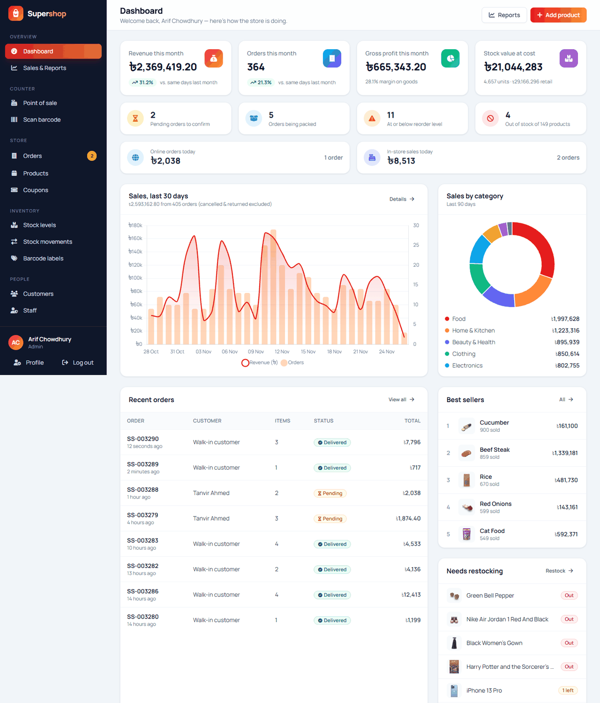

---

## Contents

- [Highlights](#highlights)
- [Quick start with Docker](#quick-start-with-docker)
- [Demo accounts](#demo-accounts)
- [Running from source](#running-from-source)
- [Who can do what](#who-can-do-what)
- [Customer guide](#customer-guide)
- [Employee guide](#employee-guide)
- [Admin guide](#admin-guide)
- [How orders work](#how-orders-work)
- [How inventory works](#how-inventory-works)
- [Barcodes and scanners](#barcodes-and-scanners)
- [Reliability: stock, money and concurrency](#reliability-stock-money-and-concurrency)
- [Configuration](#configuration)
- [Demo data](#demo-data)
- [Tests](#tests)
- [Project structure](#project-structure)
- [Tech stack](#tech-stack)
- [Production checklist](#production-checklist)

---

## Highlights

| | |
|---|---|
| 🛒 **Online shop** | Search, categories, sorting, product pages, cart with stock checks, coupons, delivery fee with free-delivery threshold, cash on delivery, order tracking, PDF invoices |
| 🧾 **Point of sale** | Scan-to-sell till for USB/Bluetooth scanners or the camera, cash / card / bKash / Nagad, automatic change, coupons, 80 mm thermal receipts |
| 🏷️ **Barcodes** | EAN-8 / UPC-A / EAN-13 / GTIN-14 with check-digit validation, auto-generated in-store barcodes, printable A4 label sheets |
| 📦 **Inventory** | Every stock change in a ledger (who, when, why, balance after): deliveries, sales, returns, write-offs, stock counts; reorder levels; weighted average cost; stock valuation |
| 🚚 **Order fulfilment** | Pending → processing → shipped → delivered, cancellations, failed deliveries and returns, with automatic stock and payment updates and a full audit trail |
| 📊 **Reports** | Revenue, profit and margin, online vs in-store, payment methods, category performance, best sellers, PDF reports (monthly, seasonal, top products, stock) |
| 👥 **Three roles** | Customers, employees (orders, till, receiving stock) and admins (everything) |
| 🔒 **Safe under load** | Row locking, idempotent till sales, coupon limits and stock that never oversell — even with many simultaneous checkouts |
| 📥 **CSV import / export** | Bulk-edit products, prices, barcodes and stock in Excel or Google Sheets |
| ⚙️ **Settings** | Store name, contact details, delivery charges, VAT, BIN and receipt text — no code changes needed |

---

## Quick start with Docker

**Requirements:** [Docker Desktop](https://www.docker.com/products/docker-desktop/) (Windows, macOS) or Docker Engine with the Compose plugin (Linux).

```bash
# 1. Get the compose file (or clone the whole repository)
curl -O https://raw.githubusercontent.com/Rafi-Siddiki/SuperShop-Management-App/main/docker-compose.yml

# 2. Start the shop and its MySQL database
docker compose up -d

# 3. Open the shop
#    http://localhost:8080
```

On first start the container generates an application key, waits for MySQL, creates the database tables and loads the demo shop (it downloads ~150 product photos, so the first start takes about a minute). Follow progress with `docker compose logs -f app` — it prints `Ready — listening on port 80` when done.

The image is published on GitHub Packages for **linux/amd64** and **linux/arm64** (Intel/AMD PCs and servers, Apple Silicon Macs, Raspberry Pi 4/5):

```
ghcr.io/rafi-siddiki/supershop-management-app:latest
ghcr.io/rafi-siddiki/supershop-management-app:1.0.0
```

### Everyday commands

| Task | Command |
|---|---|
| Stop | `docker compose down` |
| Start again (data is kept) | `docker compose up -d` |
| Update to the newest image | `docker compose pull && docker compose up -d` |
| View logs | `docker compose logs -f app` |
| Run an artisan command | `docker compose exec app php artisan <command>` |
| Delete everything, including all data | `docker compose down -v` |

### Build the image yourself

From a clone of this repository:

```bash
docker compose -f docker-compose.yml -f docker-compose.build.yml up -d --build
```

### Running a real shop (no demo data)

Create a file named `.env` next to `docker-compose.yml`:

```dotenv
SUPERSHOP_DEMO=false
SUPERSHOP_URL=https://shop.example.com
SUPERSHOP_DB_PASSWORD=a-long-random-password
SUPERSHOP_DB_ROOT_PASSWORD=another-long-random-password
```

Then `docker compose up -d` and create the first admin account:

```bash
docker compose exec app php artisan tinker --execute="App\Models\User::forceCreate(['name' => 'Owner', 'email' => 'owner@example.com', 'password' => bcrypt('choose-a-strong-password'), 'role' => 'admin', 'email_verified_at' => now()]);"
```

All Docker settings are listed under [Configuration](#configuration).

---

## Demo accounts

All demo accounts use the password **`password`**. With demo mode on, the login page has one-click buttons for them.

| Role | Email | Name |
|---|---|---|
| Admin | `admin@example.com` | Arif Chowdhury |
| Admin | `nusrat@example.com` | Nusrat Jahan |
| Employee | `employee@example.com` | Rafiq Hossain |
| Employee | `sadia@example.com`, `imran@example.com` | Sadia Akter, Imran Kabir |
| Customer | `test@example.com` | Tanvir Ahmed (has order history and items in the cart) |

Live demo coupons: **`WELCOME10`** (10 %, orders from ৳500, once per customer), **`WINTER20`** (20 %, orders from ৳1,500) and **`FLASH15`** (15 %, first 50 uses). Several expired festival coupons (`EID25`, `SALE1111`, …) show how limits and history look.

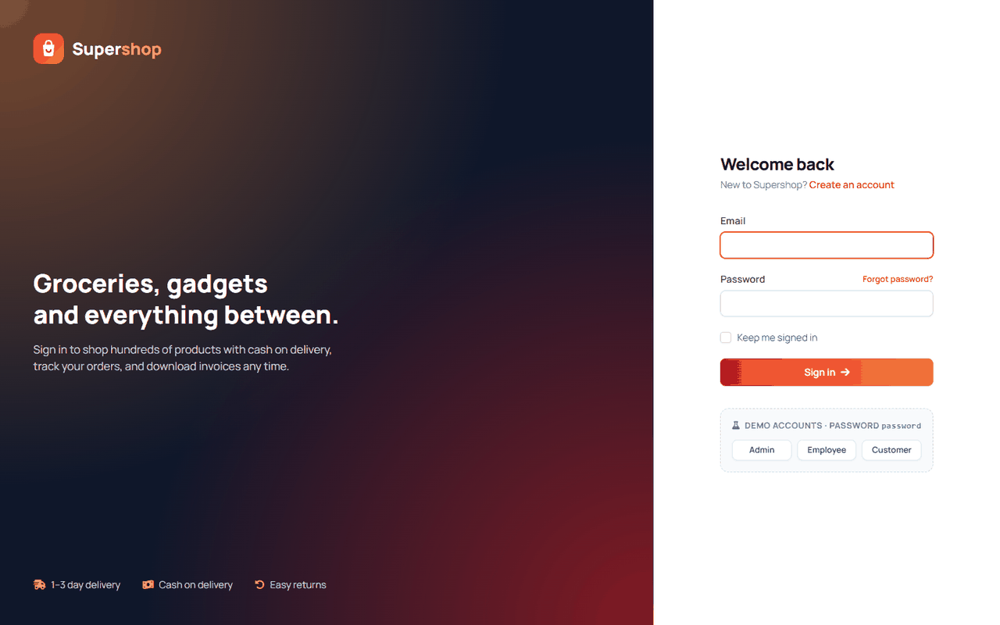

---

## Running from source

**Requirements:** PHP 8.2+ with `pdo_mysql`, `gd`, `mbstring`, `xml`, `curl`, `zip`, `intl`, `bcmath`; Composer 2; Node.js 20+; MySQL 8 (or MariaDB 10.6+).

```bash
git clone https://github.com/Rafi-Siddiki/SuperShop-Management-App.git
cd SuperShop-Management-App

composer install
npm ci && npm run build

cp .env.example .env
php artisan key:generate
# edit .env: DB_HOST, DB_DATABASE, DB_USERNAME, DB_PASSWORD (and APP_DEMO=true for demo logins)

php artisan migrate
php artisan shop:seed-demo      # optional: demo shop (only runs on an empty database)
php artisan storage:link

php artisan serve               # http://127.0.0.1:8000
```

For development with live-reloading CSS/JS run `npm run dev` alongside `php artisan serve`.

> **Tip:** `php artisan migrate:fresh --seed` wipes the database and rebuilds the demo shop. Product photos already downloaded are reused, so it also works offline.

---

## Who can do what

| Area | Customer | Employee | Admin |
|---|:---:|:---:|:---:|
| Browse the shop, cart, checkout, own orders and invoices | ✅ | | |
| Cancel own order while still pending | ✅ | | |
| Order fulfilment (confirm, ship, deliver, cancel, returns) | | ✅ | ✅ |
| Point of sale, receipts, barcode scanning | | ✅ | ✅ |
| View stock levels and movement history | | ✅ | ✅ |
| Receive deliveries into stock | | ✅ | ✅ |
| Print barcode labels | | ✅ | ✅ |
| See cost prices, margins and stock value at cost | | | ✅ |
| Write off stock, record stock counts | | | ✅ |
| Products (add, edit, pause, delete), CSV import/export | | | ✅ |
| Coupons, customers, staff accounts, settings | | | ✅ |
| Dashboard KPIs, sales reports, PDF reports | | | ✅ |

Anyone signing up through **Create account** becomes a customer. Staff accounts are created by an admin. Opening a page that belongs to another role simply takes you back to your own dashboard.

---

## Customer guide

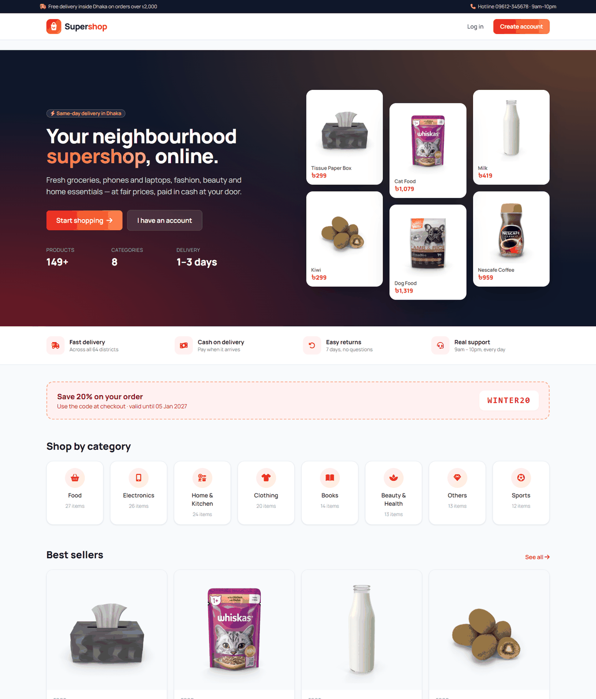

### Browsing
- **Home page** — categories, best sellers, new arrivals and the best live coupon.
- **Shop** — search by name or description (scanning or typing a product's **barcode or SKU** also finds it), filter by category, sort by popularity, newest, price or name. Badges show **New**, **Only N left** and **Sold out**.
- **Product page** — large photo, price, stock status, units sold, description, quantity picker and related products.

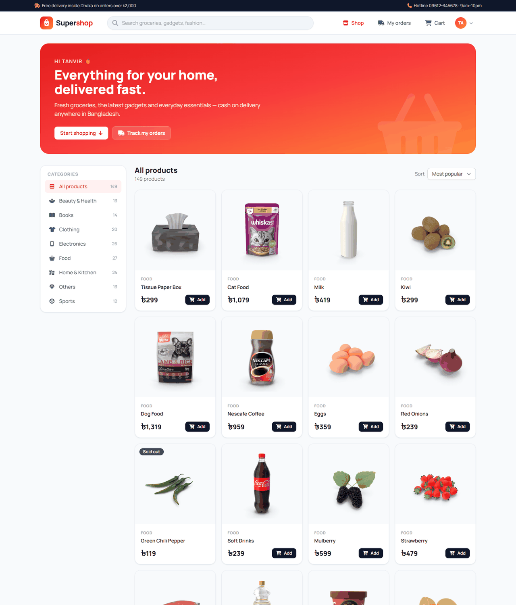

### Cart and checkout
- Quantities are limited to what is in stock (and 99 per line); deleted or paused products are removed from the cart automatically with a notice.
- **Coupons** are checked when applied and again at checkout: expiry, paused, minimum order, total uses and uses per customer. A coupon that stops qualifying (for example after removing items) is flagged and not applied.
- **Delivery fee** is added unless the order (after discount) reaches the free-delivery amount; the cart shows how much more is needed for free delivery.
- Checkout asks for a **phone number**, **delivery address** and an optional **note for the rider**. The last used address is pre-filled. Payment is **cash on delivery**.
- Prices and totals are always recalculated on the server at checkout, and stock is reserved at that moment; pressing "Place order" twice cannot create two orders.

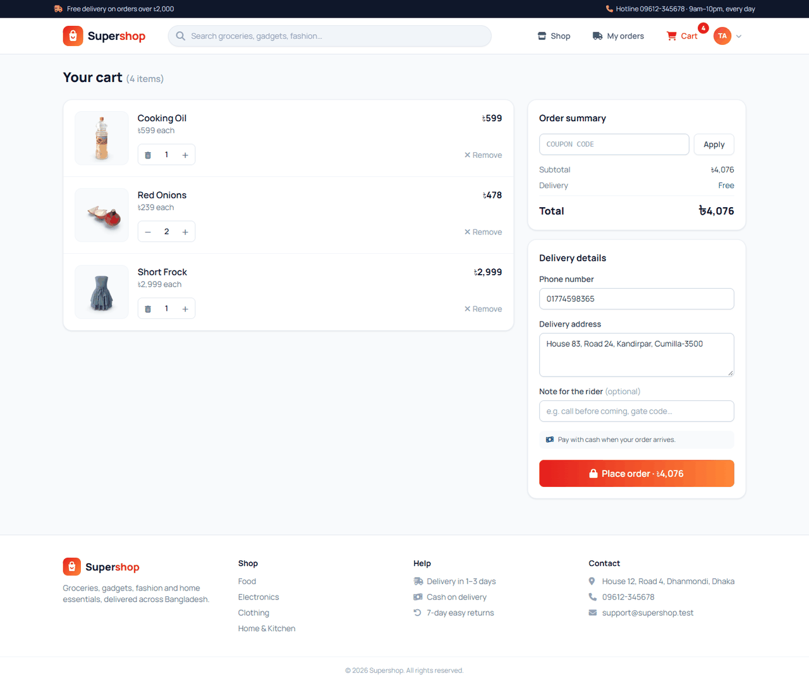

### My orders
- List of orders with status filters, product thumbnails, totals and invoice downloads.
- Order page with a progress tracker (Placed → Packing → On the way → Delivered), delivery details, discounts, delivery fee and payment status.
- **Cancel** is available while the order is still *pending*; the items go back into stock. Once staff start packing it, cancelling is no longer possible.
- **Invoice PDF** for every order.

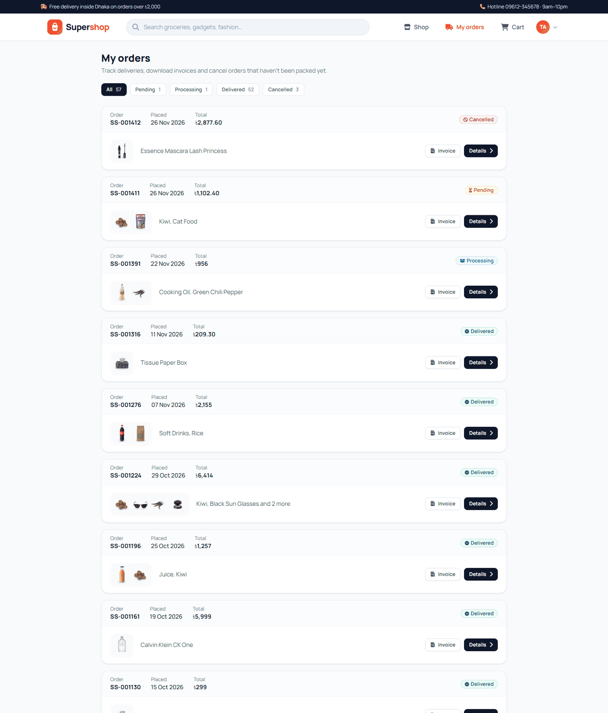

### Profile
Change name, email and password, or delete the account. Deleting an account keeps the shop's sales records (the orders remain, without the personal account).

---

## Employee guide

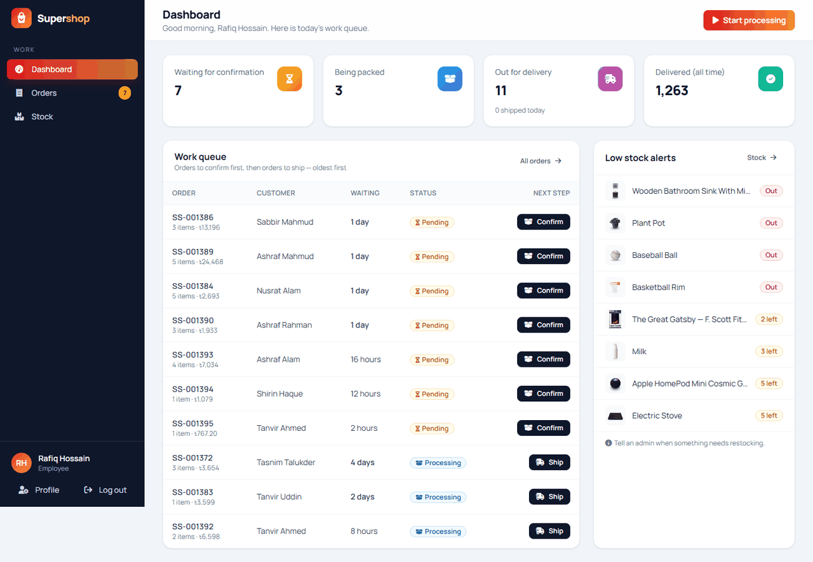

### Dashboard
- Counts of orders waiting for confirmation, being packed and out for delivery, plus **your own till sales today**.
- **Work queue** — pending orders first, then orders to ship, oldest first, with one-click **Confirm** / **Ship** buttons. Orders waiting more than a day are highlighted.
- **Low stock alerts** for products at or below their reorder level.

### Orders
- Filter by **channel** (online / in-store) and **status**, search by order number (scan the barcode on a receipt), customer name, email or phone.
- Order page: items with SKU and barcode, totals, payment method and status, delivery details, customer notes and the **history** of every status change (who, when, why).
- Actions follow the order's state: *Confirm & pack*, *Mark shipped*, *Mark delivered*, *Cancel order*, and for shipped/delivered orders **Record return** (failed delivery or customer return) — with a choice to put the items back into stock or not (e.g. damaged goods), and a warning outside the return window.

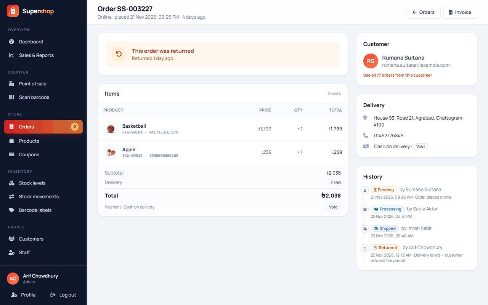

### Point of sale (till)

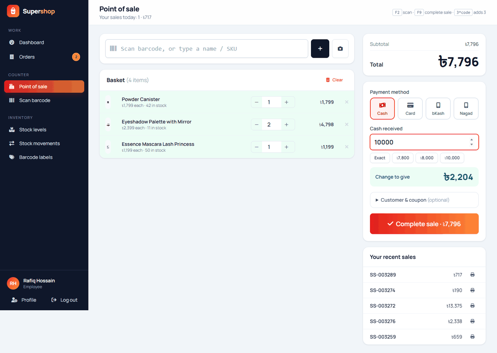

1. **Scan** each item with a USB/Bluetooth barcode scanner (it types the code and presses Enter), use the **camera** button, or type a name/SKU and pick from the suggestions.
   - `3*` before a code adds three at once (e.g. `3*8901030865275`).
   - Scanning the same item again increases its quantity.
   - A misread barcode is detected by its check digit and reported with a beep.
2. Adjust quantities or remove lines; the stock on hand is shown for each line and over-selling is flagged before payment.
3. Optionally add the customer's name/phone and a **coupon** (validated by the server, including its minimum order).
4. Choose **Cash**, **Card**, **bKash** or **Nagad**. For cash, enter the amount received (or tap a quick amount) — the **change to give** is calculated.
5. **Complete sale** (or press **F9**). The receipt opens ready to print and the till resets for the next customer. **F2** jumps back to the scan box.

The total shown is always the server's calculation. If the network drops while completing a sale, pressing Complete again is safe — the same sale is never recorded twice.

**Receipts** are formatted for 80 mm thermal printers and include the store details, items, totals, VAT (if configured), payment and change, cashier, and a barcode of the order number for returns. Reprint from *Your recent sales* or from the order page.

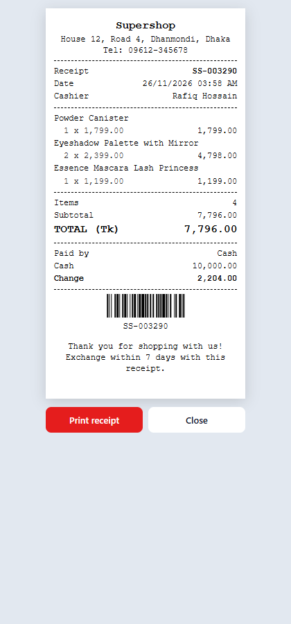

### Scan barcode
Look up any product with a scanner, the camera or by typing: photo, price, stock, reorder level, barcode, recent scans — and **receive a delivery** straight from the result.

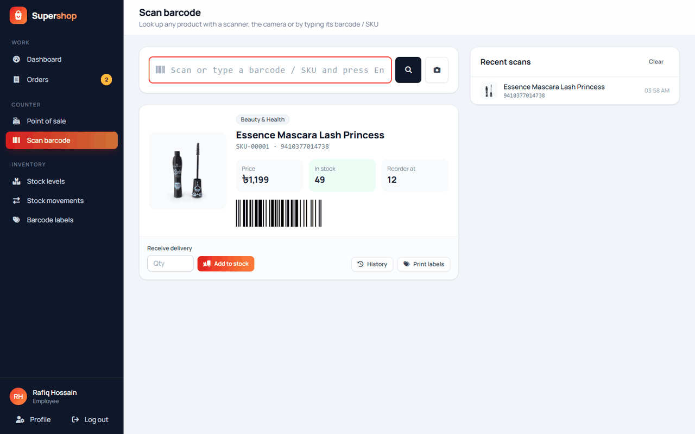

### Stock
- **Stock levels** — every product with SKU, barcode, price, stock and reorder level; filters for *needs reordering*, *running low*, *out of stock* and *inactive*.
- **Receive** a delivery (quantity and an optional note such as the supplier invoice number).
- **Stock movements** — the full ledger, filterable by type, product and date.
- **Barcode labels** — see [Barcodes and scanners](#barcodes-and-scanners).

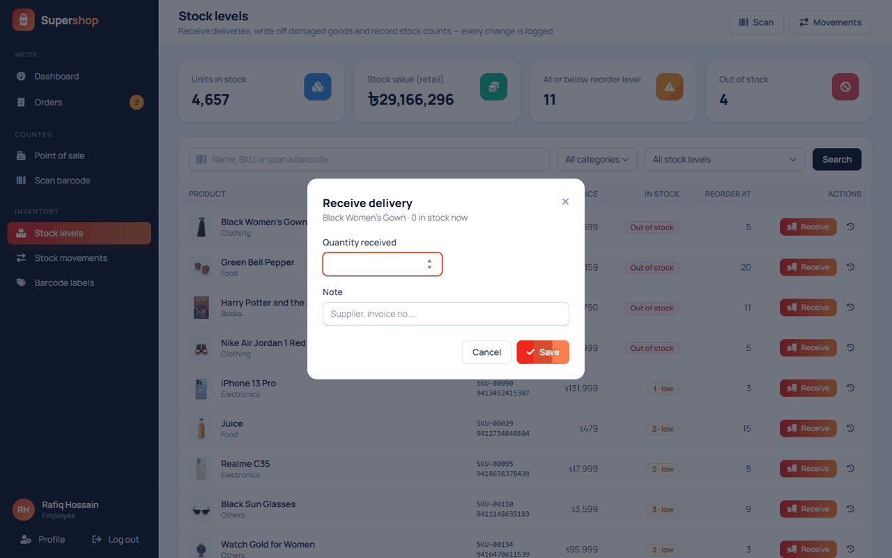

---

## Admin guide

Admins can do everything employees can, plus:

### Dashboard
Revenue and orders this month (compared with the same days last month), **gross profit and margin**, **stock value at cost**, pending and packing orders, low and out-of-stock counts, **today's online vs in-store sales**, a 30-day sales chart, sales by category, recent orders, best sellers and products that need restocking.

### Sales & reports
- Switch between the last **7, 30 or 90 days**: revenue, orders, **gross profit**, cancellation rate, daily revenue and order chart, order status mix, 12-month revenue, category performance, **online vs in-store** split and **payment methods**.
- **PDF reports**: top products (all time), seasonal report (summer / rainy / winter of any year), monthly sales report, stock report.
- Profit uses the cost price recorded on each sale, so it stays correct when costs change later.

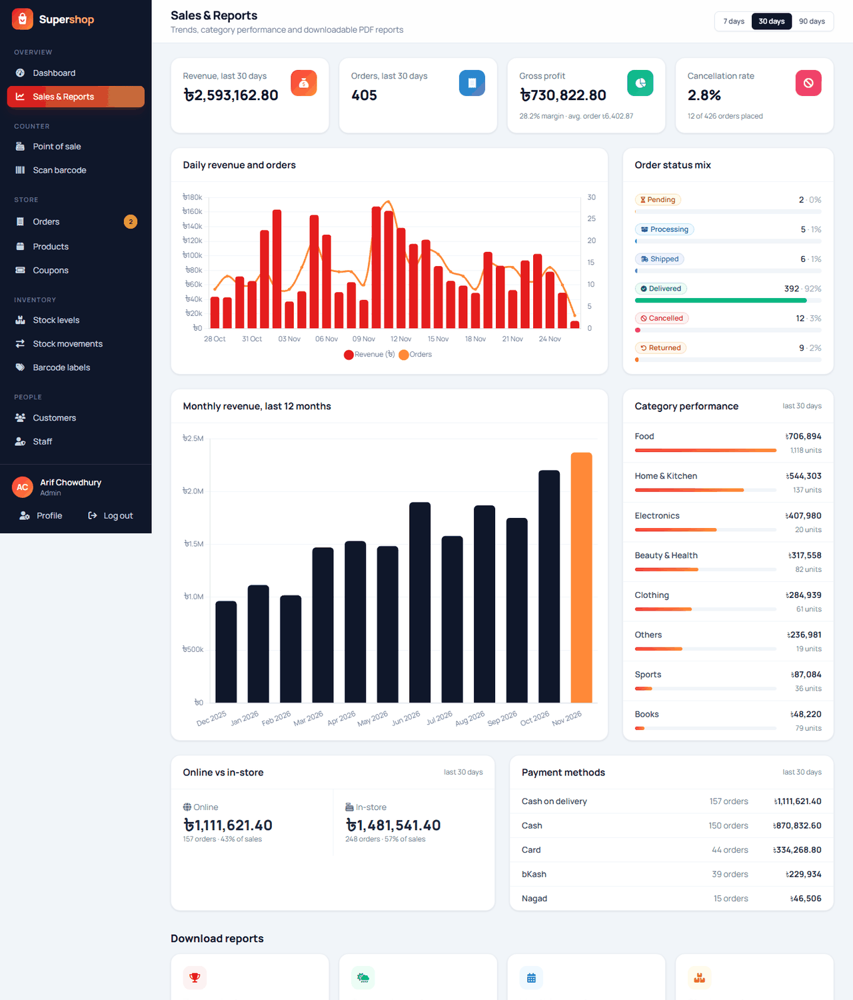

### Products
- Search (name, SKU, barcode), filter by category and active/inactive; select products to print labels in bulk.
- **Add / edit**: name, description, category, listing date, image, **selling price**, **cost price** (live margin preview), **SKU**, **barcode**, **opening stock** (new products), **reorder level**, **active** switch.
  - Leave SKU or barcode empty to generate them. Scan the pack's barcode into the field to use the manufacturer's code; codes with a wrong check digit are rejected.
  - Barcodes and SKUs are unique — including deleted products, so an old label can never scan as a different product.
- **Pause** (hide from the shop and the till without deleting) or **delete**. Deleting keeps past orders, invoices and the stock history intact.
- Categories: Food, Electronics, Clothing, Home & Kitchen, Books, Toys, Beauty & Health, Sports, Automotive, Others.

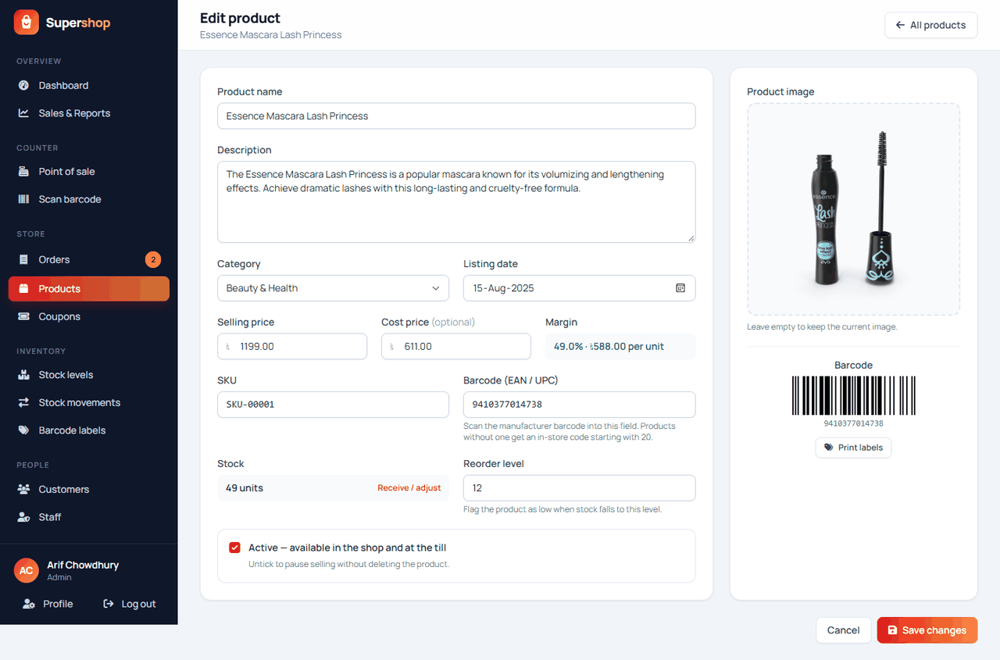

### Import & export (CSV)
- **Export** all products as CSV, edit them in Excel or Google Sheets, and **import** them back. Rows match existing products by SKU, then barcode; unmatched rows create new products.
- Every row is validated first; **if any row has a problem nothing is imported** and each problem is listed by row number.
- A `stock` column is recorded as a stock count in the ledger. A template file is available on the import page.

| Column | Required | Notes |
|---|:---:|---|
| `sku` | | letters, digits and `- _ . /`; generated if empty |
| `barcode` | | EAN-8, UPC-A, EAN-13 or GTIN-14 with valid check digit; generated if empty |
| `name` | ✅ | |
| `category` | ✅ | one of the categories above |
| `price` | ✅ | selling price in taka |
| `cost_price` | | used for profit and stock valuation |
| `reorder_level` | | default from settings |
| `active` | | `yes` / `no` |
| `stock` | | quantity on hand; differences are logged as a stock count |
| `description` | | defaults to the name |

### Inventory adjustments
- **Receive** with an optional **unit cost** — the product's cost price becomes the weighted average of the stock on hand and the new delivery.
- **Write off** stock as *damaged*, *expired* or *lost/theft* (cannot exceed what is in stock).
- **Stock count** — enter what is on the shelf; the difference is recorded (a matching count is recorded too, as proof the count happened).
- **Export inventory valuation** (CSV) and the **stock report** (PDF).

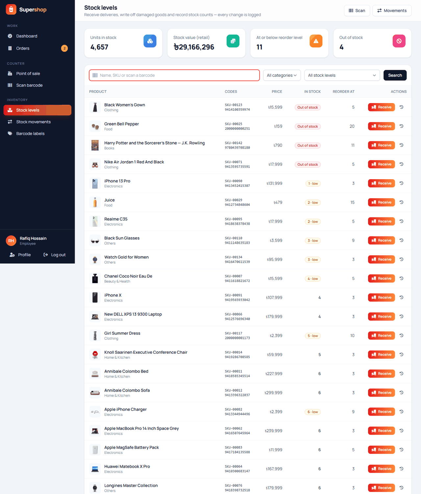

### Coupons
Create codes with a percentage discount, expiry date/time, and optional **minimum order**, **total uses** and **uses per customer**. Cards show whether a coupon is live, paused, expired or used up, how often it was used and how much discount it gave. Coupons can be **paused** or deleted (orders keep their totals). A cancelled order gives its coupon use back. Coupons work online and at the till.

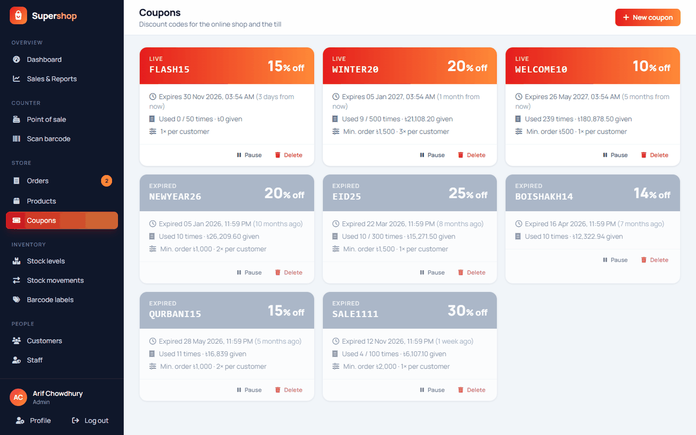

### Customers and staff
- **Customers** — ranked by lifetime spend, with order counts and last order; jump to a customer's orders.
- **Staff** — create admin or employee accounts and delete them. You cannot delete your own account here, and the last admin cannot be deleted.

### Settings

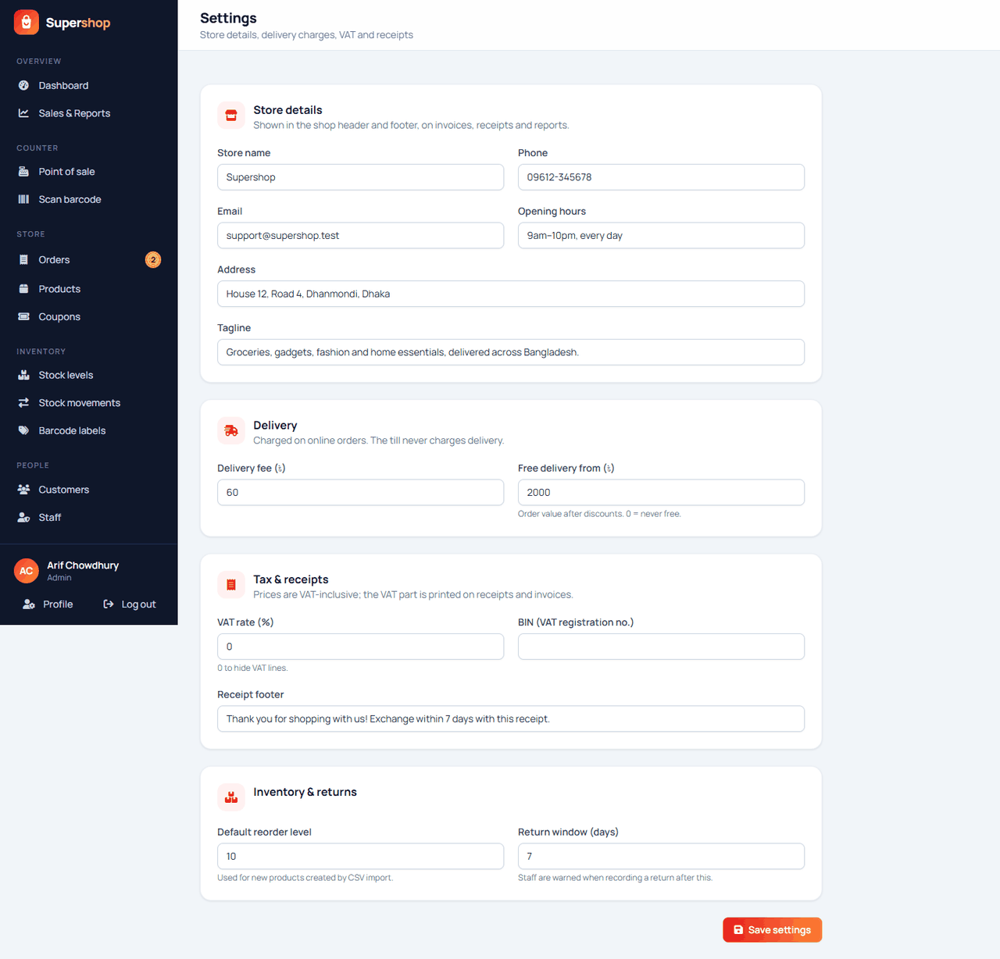

| Setting | Used for |
|---|---|
| Store name, phone, email, opening hours, address, tagline | Shop header and footer, invoices, receipts, PDF reports, browser title |
| Delivery fee, free delivery from | Online checkout (0 = never free) |
| VAT rate, BIN | VAT included in prices, printed on receipts and invoices (0 hides VAT lines) |
| Receipt footer | Last line of till receipts |
| Default reorder level | New products created by CSV import |
| Return window (days) | Warning when recording a return of an older delivery |

---

## How orders work

```
                 ┌──────────── cancelled ────────────┐
                 │                                   │
 (online) pending ──► processing ──► shipped ──► delivered ──► returned
                                        │                         ▲
                                        └── returned (failed) ────┘

 (in-store sale) ──► delivered ──► returned
```

| Change | Who | Stock | Payment |
|---|---|---|---|
| Order placed online | customer | taken from stock | unpaid (cash on delivery) |
| Sale at the till | staff | taken from stock | paid |
| pending → cancelled | customer or staff | returned to stock | void |
| processing → cancelled | staff | returned to stock | void |
| shipped → delivered | staff | — | paid (cash collected) |
| shipped → returned (failed delivery) | staff | returned to stock (optional) | void |
| delivered → returned | staff | returned to stock (optional) | refunded |

Every change is recorded in the order's history with the person, time and an optional note. Orders cannot skip steps or go backwards, and the rule is checked while the order row is locked — two people clicking at the same time cannot both change it, and a customer cannot cancel an order that staff have just confirmed.

**Revenue** in reports counts orders that are pending, processing, shipped or delivered; cancelled and returned orders are excluded.

---

## How inventory works

Stock is never edited directly: every change goes through one service that locks the product's stock row, refuses to go below zero and writes a ledger entry with the **balance after** the change. For every product, the ledger adds up exactly to the current stock.

| Movement | Change | Created by |
|---|:---:|---|
| Opening stock | + | adding a product |
| Received | + | receiving a delivery (optionally with unit cost) |
| Online sale / In-store sale | − | checkout / till |
| Order cancelled | + | cancelling an order |
| Customer return | + | recording a return with restock |
| Damaged / Expired / Lost | − | admin write-off |
| Stock count | ± | admin stock count or CSV import |

Each product has a **reorder level**; products at or below it appear in the dashboard alerts and the *needs reordering* filter.

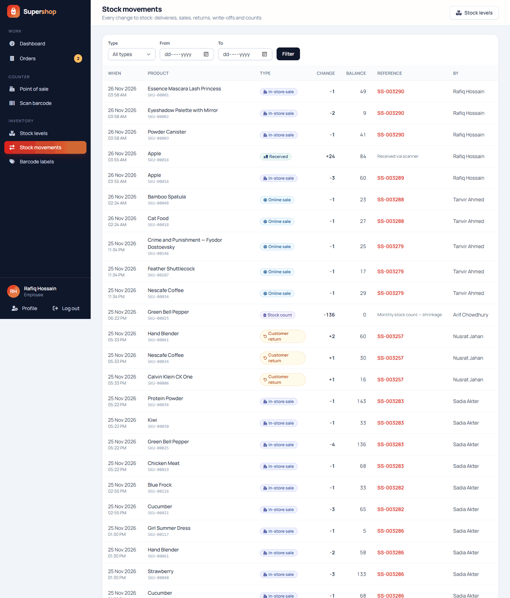

---

## Barcodes and scanners

- **Formats**: EAN-8, UPC-A (12 digits), EAN-13 and GTIN-14, always with a valid GS1 check digit. Books can use their ISBN-13.
- **Generated codes**: products without a barcode get an in-store EAN-13 beginning with `20` (the GS1 range reserved for in-store use, so it never clashes with a manufacturer's code), e.g. `2000000000015`. SKUs default to `SKU-00001`.
- **USB / Bluetooth scanners** work out of the box in any scan field (they behave like a keyboard). Spaces and dashes in scanned codes are ignored.
- **Camera scanning** (till and scan page) reads EAN, UPC, Code 128, Code 39 and ITF. Browsers only allow the camera on `https://` sites or on `localhost`.
- **Labels**: *Barcode labels* prints A4 sheets of **24 labels (3 × 8, 63.5 × 33.9 mm — Avery L7159 layout)** with name, optional price and barcode. Pick products and copies, and *skip positions* to reuse a partly used sheet. Print at 100 % scale.
- **Receipts** carry a Code 128 barcode of the order number; scanning it into the order search opens the order.

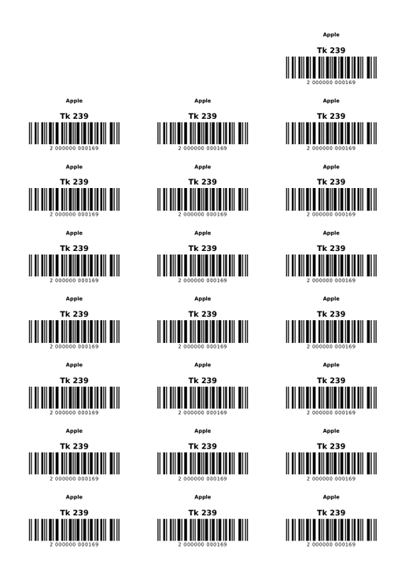

---

## Reliability: stock, money and concurrency

- **No overselling** — stock rows are locked (`SELECT … FOR UPDATE`) in a fixed order during checkout, till sales, cancellations and adjustments; the stock column is unsigned as a final safeguard.
- **No duplicate orders** — the cart is locked during checkout; each till sale carries a one-time key, so a double click or a retried request returns the same sale.
- **Coupon limits hold** — the coupon row is locked and usage counted with locking reads.
- **Deadlock-safe** — transactions are retried automatically if the database picks one as a deadlock victim.
- **Exact money** — totals are calculated in whole paisa, never from prices sent by the browser.
- **Unique codes** — database indexes guarantee one stock row per product, one active cart per customer, one cart line per product, and unique barcodes and SKUs.
- **History is kept** — deleting products, coupons or customers never deletes orders, invoices or the stock ledger.

These guarantees were verified with up to 40 simultaneous processes against MySQL (e.g. 40 buyers for the last 5 units → exactly 5 orders, stock exactly 0, ledger consistent).

---

## Configuration

### Docker (`docker-compose.yml`)

Set these in your shell or in a `.env` file next to `docker-compose.yml`. They are prefixed `SUPERSHOP_` so they never clash with Laravel's own `.env`.

| Variable | Default | Meaning |
|---|---|---|
| `SUPERSHOP_PORT` | `8080` | Port on your computer |
| `SUPERSHOP_URL` | `http://localhost:8080` | Public URL of the shop |
| `SUPERSHOP_APP_KEY` | *(generated)* | Laravel `APP_KEY`; generated on first start and kept in the `storage` volume if empty |
| `SUPERSHOP_DEMO` | `true` | Load demo data into an empty database and show demo logins |
| `SUPERSHOP_TIMEZONE` | `Asia/Dhaka` | Application timezone |
| `SUPERSHOP_DB_PASSWORD` | `supershop-secret` | MySQL user password |
| `SUPERSHOP_DB_ROOT_PASSWORD` | `supershop-root-secret` | MySQL root password |

The image itself also accepts the standard Laravel variables (`APP_*`, `DB_*`, `MAIL_*`, …) plus `RUN_MIGRATIONS` (default `true`) and `SEED_DEMO_DATA` (default `false`). Data lives in two named volumes: `db-data` (MySQL) and `storage` (product images, sessions, generated app key).

### From source (`.env`)

Standard Laravel settings; notable ones: `APP_TIMEZONE` (default `Asia/Dhaka`), `APP_DEMO` (show demo logins), `DB_*`. Store details, delivery fee, VAT etc. are edited in **Settings** inside the app.

---

## Demo data

`php artisan shop:seed-demo` (or `SUPERSHOP_DEMO=true` with Docker) loads, into an **empty** database only:

- 2 admins, 3 employees and 65 customers with Bangladeshi names and addresses across Dhaka, Chattogram, Sylhet, Rajshahi, Khulna and Cumilla;
- 149 products in 8 categories with real photos — product data and images from [DummyJSON](https://dummyjson.com), book covers from [Open Library](https://openlibrary.org); prices in taka, cost prices, reorder levels, barcodes (books use their ISBN);
- a year of trading: ~1,400 online orders and ~1,900 in-store sales growing over time, with weekend peaks and spikes around Eid, Pohela Boishakh, New Year and the 11.11 sale; cancellations, failed deliveries and returns; coupon use within each coupon's limits;
- a stock ledger replayed in time order — supplier deliveries before stock runs low, occasional write-offs and stock counts — that matches current stock exactly, with a few products low or sold out.

Photos are downloaded on first run (internet needed); without internet, products show a placeholder image.

---

## Tests

```bash
php artisan test
```

93 tests cover checkout totals, delivery fees, coupon limits, stock checks, double submissions, cancellations, returns, order transitions under stale data, role access, the till (pricing, change, idempotency, stock), barcode validation and lookup, inventory operations and the ledger, CSV import/export and settings. Tests run on an in-memory SQLite database and never touch your real data.

---

## Project structure

```
app/
├── Http/Controllers/
│   ├── AdminController.php           dashboard, customers, sales reports
│   ├── CartController.php            cart, coupons, checkout
│   ├── PosController.php             till, price quotes, receipts
│   ├── BarcodeController.php         lookups, scan page, barcode images, label sheets
│   ├── InventoryController.php       stock levels, receive, write-off, count, ledger, exports
│   ├── ProductController.php         products and PDF reports
│   ├── ProductImportController.php   CSV import/export
│   ├── Manage/OrderController.php    order fulfilment for staff
│   └── …                             customer shop, orders, coupons, staff, settings, invoices
├── Services/
│   ├── OrderService.php              checkout, till sales, status transitions (locking, totals)
│   └── InventoryService.php          every stock change + ledger (locking, costs)
├── Models/                           Product, Stock, StockMovement, Order, OrderItem,
│                                     OrderStatusHistory, Cart, Coupon, Setting, User
├── Support/Barcode.php, Money.php    GS1 check digits & rendering; paisa arithmetic
└── Http/Middleware/Role.php          role-based access
database/migrations, database/seeders (+ seeders/data/products.json)
resources/views/                      Blade views (Tailwind + Alpine.js)
routes/web.php, routes/console.php    routes; `shop:seed-demo` command
docker/, Dockerfile, docker-compose*.yml
tests/Feature, tests/Unit
```

---

## Tech stack

- **Backend:** Laravel 11, PHP 8.3, MySQL 8.4
- **Frontend:** Blade, Tailwind CSS 3, Alpine.js, Vite, Chart.js, Font Awesome
- **Documents & barcodes:** barryvdh/laravel-dompdf, picqer/php-barcode-generator, html5-qrcode (camera scanning)
- **Container:** PHP 8.3 + Apache (Debian), multi-stage build, multi-architecture image on GitHub Packages
- **Tests:** Pest

---

## Production checklist

- Set `SUPERSHOP_DEMO=false` (or `APP_DEMO=false`) and don't seed demo data; create your own admin account.
- Use strong database passwords and keep `APP_KEY` safe — losing it logs everyone out.
- Serve the shop over **HTTPS** (needed for camera scanning) behind a reverse proxy such as Caddy, Traefik or Nginx.
- Back up the `db-data` and `storage` volumes (or your MySQL database and `storage/app/public`).
- Fill in **Settings** (store details, delivery fee, VAT/BIN) before opening.
- Run `composer audit` periodically and update dependencies.
